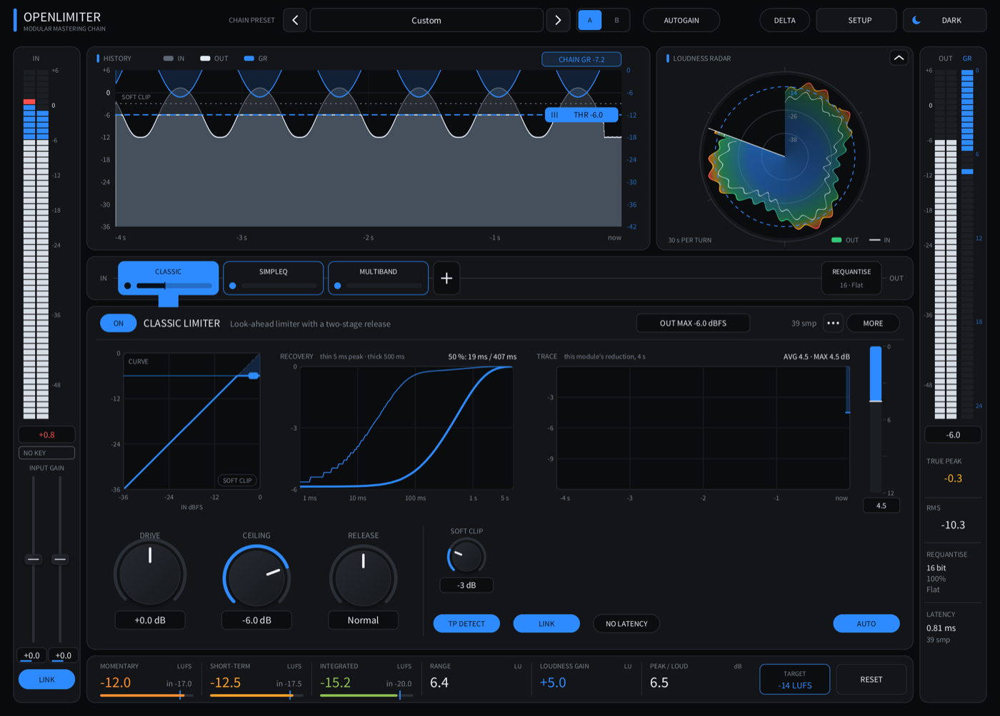
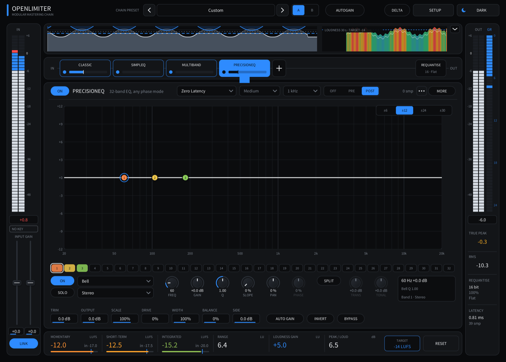
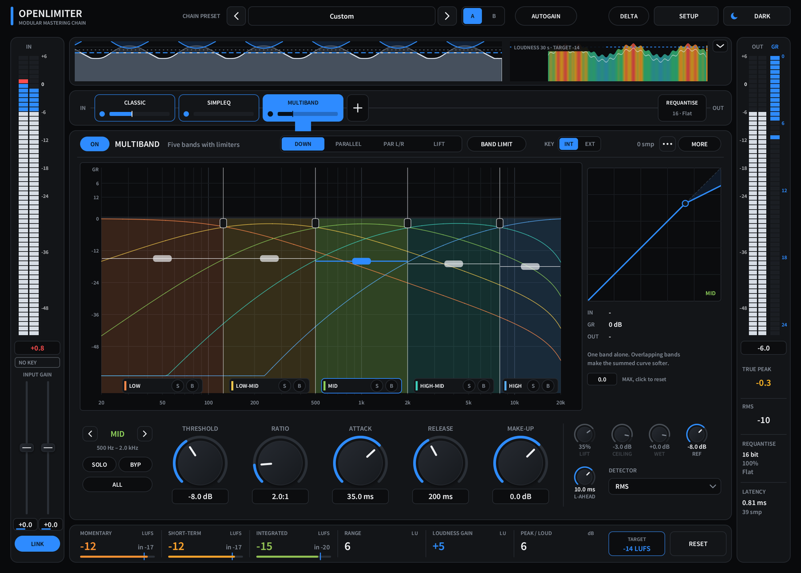
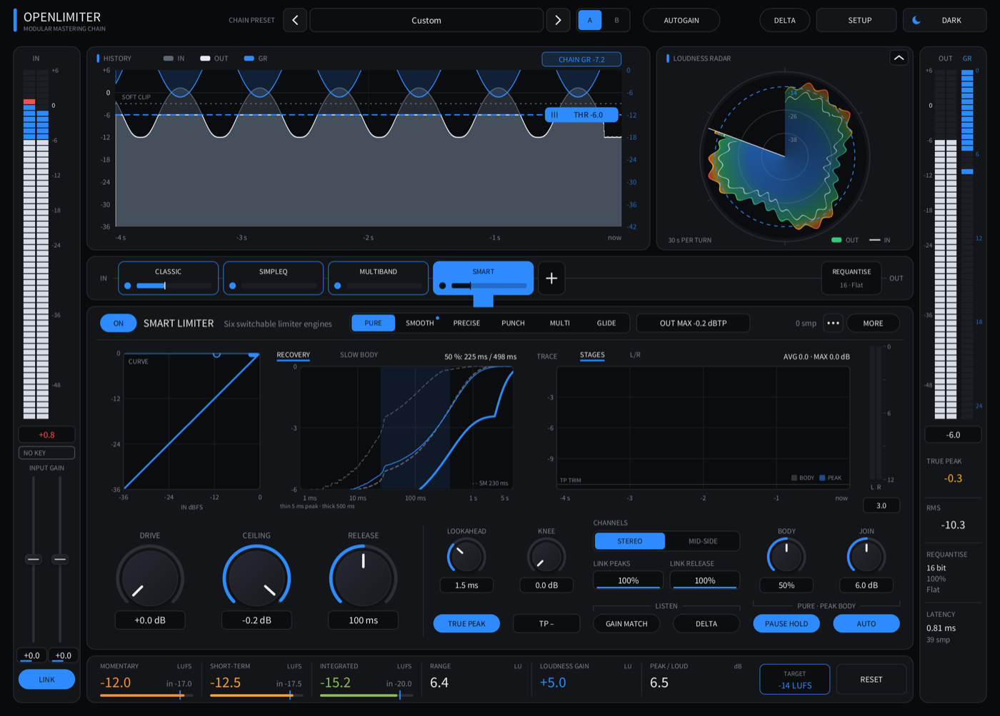
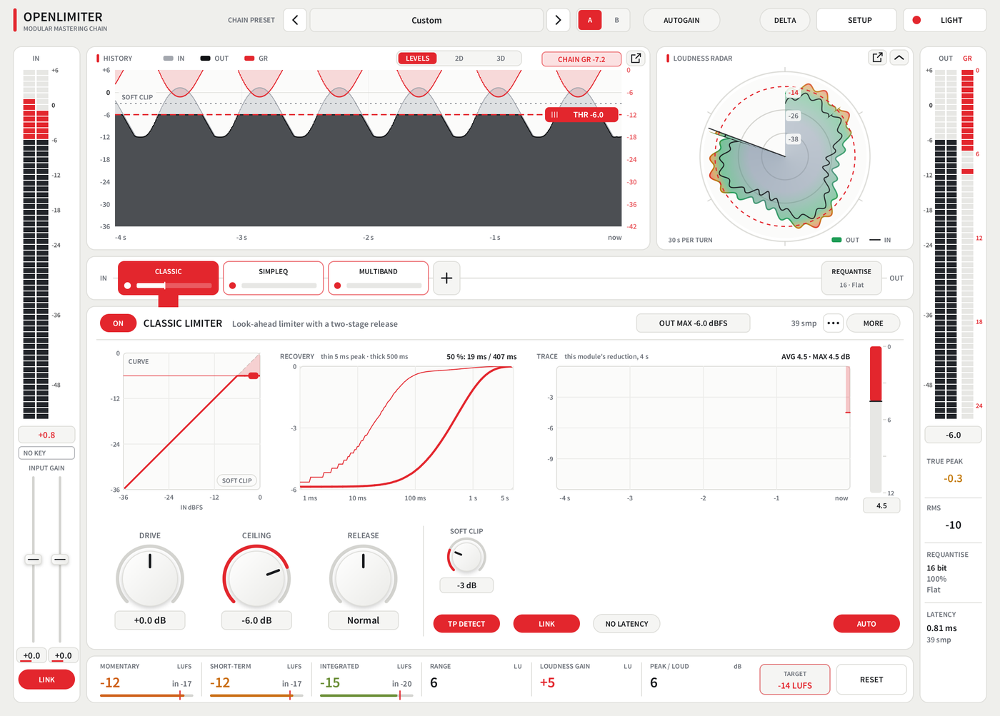

# OpenLimiter

**A modular mastering chain in one plugin, by OpenGrid.** Seventeen modules
(limiters, compressors, expanders, equalisers and colour) that you switch on,
put in any order and set on one page each, ending in a word-length stage. It is
made to be the last plugin before the master is printed.

| PrecisionEQ | Multiband |
|---|---|
|  |  |

| Smart Limiter | Light theme |
|---|---|
|  |  |

*The pictures are rendered from the plugin's own editor code.*

## Version 1.0.1-Beta

The first public release.

- Seventeen modules in one movable chain, each with its own page, plus
  Requantise (word length, dither, noise shaping) pinned at the end.
- Input and output meters, true peak, RMS, BS.1770 loudness with a history and
  a loudness radar.
- Autogain and Delta to hear the processing at matched loudness, or only what
  it changes.
- External sidechain for modules with a key, lined up through the chain.
- A/B, factory presets and four themes.

## Download

**macOS 11 or later, Apple silicon and Intel:**
[OpenLimiter-1.0.1-Beta-macos.pkg](https://github.com/MistaMin/OpenLimiter/releases/download/v1.0.1-Beta/OpenLimiter-1.0.1-Beta-macos.pkg) ·
[User manual (PDF)](https://github.com/MistaMin/OpenLimiter/releases/download/v1.0.1-Beta/OpenLimiter-1.0.1-Beta-User-Manual.pdf)

The installer offers **VST3, Audio Unit, CLAP, LV2 and AAX**. It is signed with
Developer ID and notarized by Apple, and the AAX is signed with PACE Eden for
Pro Tools.

**Windows 10 or later, x64:**
[OpenLimiter-1.0.1-Beta-windows-x64-setup.exe](https://github.com/MistaMin/OpenLimiter/releases/download/v1.0.1-Beta/OpenLimiter-1.0.1-Beta-windows-x64-setup.exe)
installs **VST3 and CLAP** with the editor. It is not code-signed, so Windows
may ask before running it.

**Linux x86_64:**
[OpenLimiter-1.0.1-Beta-linux-x86_64.tar.gz](https://github.com/MistaMin/OpenLimiter/releases/download/v1.0.1-Beta/OpenLimiter-1.0.1-Beta-linux-x86_64.tar.gz)
holds **CLAP and LV2** without an editor; the host shows its own controls.

Checksums are on the
[release page](https://github.com/MistaMin/OpenLimiter/releases/tag/v1.0.1-Beta).

This is a beta. The Windows and Linux builds are made by GitHub Actions and
have not been tested in a host yet. There is no standalone application.

## User guide

See the [user manual](docs/USER_MANUAL.md) and the generated
[parameter reference](docs/PARAMETERS.md). Changes are in the
[changelog](CHANGELOG.md) and the [release notes](RELEASE_NOTES.md).

## Build from source

OpenLimiter is written in Rust on OpenPluginSDK, with a GoodLookinDri editor.
Check out [OpenPluginSDK](https://github.com/MistaMin/OpenPluginSDK) at the
revision named in `scripts/build.sh` so that it sits at
`../../Dependencies/OpenPluginSDK` relative to this folder, then:

    cargo test --release
    scripts/build.sh            # macOS: VST3, AU, CLAP, LV2 (and AAX with an AAX SDK) into dist/

The Windows and Linux builds are in `.github/workflows/build.yml`.

| Folder | What |
|---|---|
| `src/` | the chain, the first limiter, loudness, the monitor stage and the editor (`src/ui/`) |
| `crates/` | one crate per module, each with its own tests |
| `docs/` | user manual, parameter reference, pictures |
| `qa/` | test records |
| `scripts/`, `tools/` | build and manual scripts |

## License

The source code is MIT licensed, copyright Marcos Quirino Deida (`LICENSE`).
The official binaries are freeware under `BINARY_LICENSE.txt`. Third-party
components keep their own licences: see `THIRD_PARTY_LICENSES.md`.

VST is a trademark of Steinberg Media Technologies GmbH. Audio Units is a
trademark of Apple Inc. AAX and Pro Tools are trademarks of Avid Technology,
Inc.
