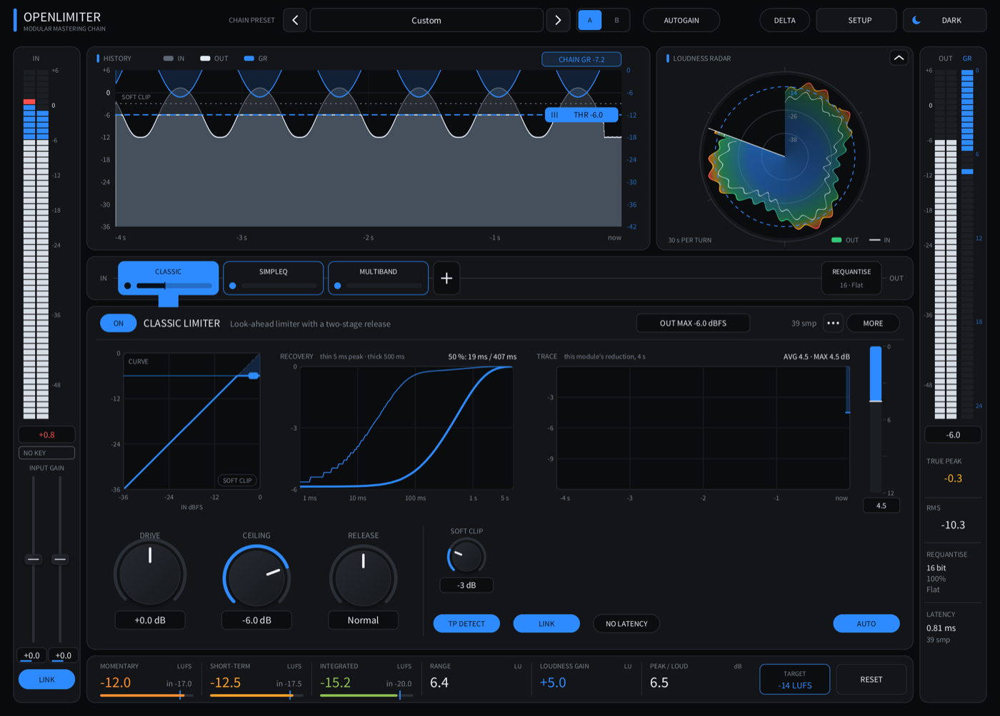

# OpenLimiter User Manual

OpenLimiter is a modular mastering chain by OpenGrid: seventeen processing modules that you switch on, order and set in one plug-in, followed by a word-length stage (Requantise). It is built to be the last plug-in before the master is printed, so it has no output gain after its limiters.

Version 1.0.0 Beta. This is a beta: the processing has been measured and tested, but it has not yet had a full listening review. Report anything that sounds wrong.

## Formats and systems

| System | Formats | Editor |
|---|---|---|
| macOS 11 or later, Apple silicon and Intel | VST3, Audio Unit, CLAP, LV2, AAX | yes |
| Windows 10 or later, x64 | VST3, CLAP | yes |
| Linux x86_64 | CLAP, LV2 | no: the host shows its own controls |

## Signal path

Input, then input gain, then the input meters and loudness, then the modules in the order you set, then Requantise (always last), then the output meters, loudness and true peak, then the output.

Autogain and Delta, the two listening aids on the top bar, come after the output meters. The meters always show the real output.

## The window

### Top bar

- **Chain preset**: the arrows step through the factory presets; the name shows Custom once you change something.
- **A / B**: two complete settings to compare. Click the other letter to switch.
- **AUTOGAIN**: plays the output at the loudness of the plug-in's input (measured before the input gain), so that a louder master does not sound better only for being louder. It measures loudness over about 3 seconds, reaches at most 24 dB either way, and holds its gain while the input is quiet. The gain it applies is shown next to the switch.
- **DELTA**: plays only what OpenLimiter changes: the output minus the input (after the input gain), lined up for the plug-in's delay. With Autogain also on, the difference is played at the matched level.
- **SETUP**: theme, readouts and the channel alignment controls (below).
- **Theme**: dark, light, graphite or paper.

Autogain and Delta change what leaves the plug-in. **Switch both off before you print or bounce.** They are never stored in presets.

### Meters and displays

- **Left rail**: input level per channel, input gain faders with their link.
- **History**: input, output and gain reduction over the last seconds, with the threshold and the soft clip level of the page you are on.
- **Loudness radar**: short-term loudness, 30 seconds per turn, output in colour and input as a line.
- **Right rail**: output level and gain reduction, true peak, RMS, the Requantise settings and the total latency.
- **Bottom bar**: momentary, short-term and integrated loudness (LUFS) with the input value beside each, loudness range, loudness gain, peak to loudness ratio, and a target with its reset.

The numbers refresh four times a second so they can be read.

### The rack

The rack shows the modules in the chain, in signal order.

- Click a module's dot to switch it on or off.
- Click its name to open its page.
- Drag a module to move it in the chain.
- **+** adds a module that is not shown yet; a module can also be removed from the rack.
- **REQUANTISE** is fixed at the end of the chain.

Each module's page has its on switch, its name, a short description, its own latency, and the **MORE** button where a module has further controls.

## Modules

### Limiters

| Module | What it does |
|---|---|
| Classic Limiter | Look-ahead limiter with a two-stage release (automatic or manual), oversampled peak detection, soft clip and channel link. |
| Loudness MAX | Maximizer with ten styles and three types. |
| Clean Peak | Transparent peak limiter. |
| Final Wall | Wall limiter with an input clipper; two look-ahead styles and strict true-peak control. |
| Smart Limiter | Six switchable limiter engines. |

### Compressors

| Module | What it does |
|---|---|
| DualSone | Leveller plus transient engine. |
| Compressor / De-esser | Two-set compressor, wide band or one band. |
| Multiband | Five bands, each with a compressor and an optional band limiter. |
| Harmonic Compressor | Compressor with seven styles. |

### Expanders

| Module | What it does |
|---|---|
| Dynamics Restore | Restores peaks that earlier processing took away. |
| Floor Lifter | Lifts quiet parts and tails. |

### EQ and spectral

| Module | What it does |
|---|---|
| SimplEQ | Six bands and a low cut, in left/right or mid/side. |
| PrecisionEQ | 32-band equaliser with five processing modes: Zero Latency, Linear Phase, Analog, Mix and Analog ZL. |
| DynEQ | 32-band dynamic equaliser with an internal or external key. |
| Suppressor | Tames ringing resonances. |

### Colour

| Module | What it does |
|---|---|
| Punch & Energy | Lift, punch and saturation. |
| Overtone Generator | Adds the 2nd to 5th harmonics without aliasing. |

### Requantise

Reduces the word length for the delivery format, with dither, noise shaping, auto-blank for silent passages and a DC filter. It is always the last stage. Set the word length to that of the file you deliver (for example 16 bit for CD); leave it Off for 32-bit float delivery.

## Sidechain

Modules with a key show **KEY INT / EXT** in their header. With EXT, the module listens to the plug-in's sidechain input instead of its own signal. Each module receives the key delayed by the latency of the modules ahead of it, so the key stays lined up.

## Latency

Several modules look ahead or use linear-phase filters, and their delay adds up. The total is shown on the right rail and reported to the host, which compensates for it. Each module's own latency is shown in its header.

## Setup

| Control | What it does |
|---|---|
| Delay L / R and Delay Fine | Delays one channel against the other (alignment). |
| Delay Unit | Shows the delay in milliseconds or in frames at 24, 25 or 30 frames per second. Display only. |
| Phase Inv L / R | Inverts the polarity of a channel. |
| Headroom | Kept so that older sessions load; it has no effect on the sound. |
| RMS readout | Plain RMS (default) or with the AES +3 dB offset; window 2 seconds by default. |

## Factory presets

Default, Ceiling 0 dBFS, Ceiling -6 dBFS, Broadcast EU, Broadcast US, Soft Clip -12 dBFS.

## Before you print

- Switch Autogain and Delta off.
- Set Requantise to the delivery word length.
- Check the true peak reading against your delivery limit.

## Known limits of this beta

- No listening review has been done yet.
- Some readouts can show "-0.0".
- Linux has no editor; the host's generic controls are used.
- Windows has no LV2 and no AAX.
- The Windows and Linux builds are made by automated builds and have not been tested in a host.

## License

OpenLimiter's source code is MIT licensed. The official binaries are freeware under `BINARY_LICENSE.txt`. Third-party components keep their own licences: see `THIRD_PARTY_LICENSES.md`.

VST is a trademark of Steinberg Media Technologies GmbH. Audio Units is a trademark of Apple Inc. AAX and Pro Tools are trademarks of Avid Technology, Inc.
